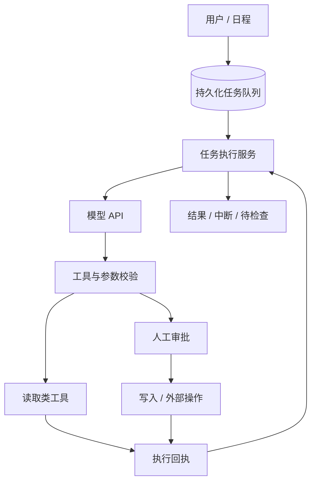

# 个人 Agent 助手

**一个本地优先的个人工作助手，将模型决策、工具执行、人工确认和持久化任务连接起来。**

基于 Python、Streamlit 与 SQLite。提供对话式任务入口、文档读取与生成、个人记忆、日程调度，以及可选的浏览器、邮箱和桌面通信能力。模型通过明确注册的工具工作，执行结果与对话文本分别记录。

> 本仓库已完成主体重构及静态代码检查。当前版本尚未完成本轮端到端运行验证，不宣称生产 SLA、商业认证或无人值守成功率。适用定位为单机、单用户个人助手；不包含注册、订阅或多租户系统。

## 核心能力

| 能力 | 实现 | 执行边界 |
| --- | --- | --- |
| 对话与任务 | 工具调用循环、前四轮对话上下文、持久化任务队列 | 模型需支持 OpenAI 兼容 function calling |
| 文档工作 | TXT / Markdown / CSV / JSON / PDF / DOCX 读取与关键词片段检索 | 文本 PDF；单文件最大 10 MiB |
| 文档生成 | 创建 Markdown、Word，新文件可在界面下载 | 需确认，不覆盖原件 |
| 个人记忆 | 保存、查看和删除用户偏好及笔记 | 模型写入需确认 |
| 日程 | 单次和固定间隔任务、过期跳过、重叠抑制 | 应用运行且电脑唤醒时有效 |
| 审批续接 | 审批绑定参数、过期处理、批准后续接、拒绝后停止 | 对外操作与本地写入需确认 |
| 网页操作 | Kimi WebBridge 复用标签、读取页面、查看控件、点击和填写 | 使用本人登录态；默认禁用 |
| 邮箱 | 打开 QQ 邮箱写信页并填写草稿 | 最终发送由用户完成 |
| QQ / 微信 | 可访问控件的未读检查和确认后发送 | Windows 客户端与控件适配要求 |
| 用量与追踪 | 输入/输出 Token、步骤事件、工具参数与回执、摘要导出 | 无服务端 usage 时显示保守估算 |
| 实用工具 | 安全四则运算、当前时间 | 不开放任意代码执行 |

求职工作台作为独立扩展保留在 `career_app.py`，不再是主产品入口。

## 快速开始

要求 Python 3.10+。主应用不依赖 GPU，也不要求先配置浏览器插件。

```powershell
python -m venv .venv
.\.venv\Scripts\python.exe -m pip install -e .
Copy-Item .env.example .env
```

在本机 `.env` 填写：

```dotenv
MODEL_API_KEY=your-local-api-key
MODEL_BASE_URL=https://your-provider.example/v1
MODEL_NAME=your-function-calling-model
```

随后启动：

```powershell
.\.venv\Scripts\python.exe -m streamlit run app.py
```

在浏览器访问 `http://127.0.0.1:8501`。首次打开“工具与设置”，核对模型与预算；上传资料后，在“对话”发起任务。示例域名是占位符，需要替换为实际服务商地址。

可选依赖按需安装：

```powershell
python -m pip install -e ".[desktop]"   # Windows QQ / 微信
python -m pip install -e ".[ocr]"       # 历史求职扩展的图像识别
python -m pip install -e ".[dev]"       # 静态检查工具
```

网页能力还需要安装并启动 Kimi WebBridge 本地服务，启用扩展并登录目标网站。应用不会代替用户登录，也不会自动启动远程调试浏览器。

## 工作区

- **概览**：任务数量、待审批、Token 与运行动态。
- **对话**：发起任务、继续已完成对话、查看工具执行和停止任务。
- **任务与日程**：按日期查看下一次运行，添加日程，检查历史任务。
- **审批中心**：核对具体操作参数后批准或拒绝。
- **文件与记忆**：上传资料、下载生成文档、维护个人偏好。
- **工具与设置**：模型接口、运行预算、超时、工具分组和环境要求。

界面采用深灰色工作区与独立黑色运行终端。页面刷新仅读取状态，模型调用由后台工作线程执行。

## 架构



任务执行线程、日程线程与 UI 分离。单个数据目录只有一个工作进程持有执行锁；任务串行执行，审批等待时释放工作线程。多个任务可以排队，日程仍可入队，不会让两个任务同时控制同一浏览器。

关键工程机制：

- 参数化 SQL、WAL、外键、事务内原子领取任务。
- 工具注册白名单与 JSON Schema 校验；可选依赖延迟加载。
- 操作前记录动作，操作后保存结果；同任务重复写入请求复用回执。
- 不确定的外部结果标记为 `UNKNOWN`，不自动重试。
- 审批绑定完整参数，30 分钟有效；网页点击/填写同时核对页面快照指纹。
- 重启后中断旧任务并使旧审批失效，不自动补跑已经错过的日程。
- 单任务轮次、输出上限、Token 预算和请求超时共同限制执行。
- 文件读取限定在用户资料目录；生成内容保存到独立产物目录。

## 工程目录

```text
app.py                         主应用入口
career_app.py                  可选的历史求职扩展
src/
  assistant/
    ui.py                      展示与用户输入
    runtime.py                 模型循环、执行、审批续接、工作进程
    store.py                   任务、动作、日程、记忆及用量持久化
    model.py                   OpenAI 兼容 HTTP 适配
    tools.py                   能力注册与参数约束
  tools/                       网页、邮箱、桌面和旧版本兼容适配
  core/system/                 统一路径与模型设置
  core/tasks/                  工具执行上下文
  career/                      独立求职业务流程
config/settings.py             环境配置入口
scripts/                       静态检查、源码发布包
.github/workflows/static.yml   GitHub 静态检查
.streamlit/config.toml         本机绑定与深色主题
pyproject.toml                 依赖、包信息、静态检查规则
```

设计细节见 [架构说明](docs/architecture.md)，数据路径、配置优先级、备份和故障处理见 [运维说明](docs/operations.md)。

## 数据与隐私

原始资料位于 `data/users/`；助手的任务、审批、日程、记忆和用量位于 `data/agent/operations/assistant.sqlite3`。生成文档位于 `data/agent/artifacts/documents/`。所有持久化路径统一由 `PathManager` 声明，可使用 `PERSONAL_AGENT_DATA_DIR` 指定独立的私人数据目录。

读取资料用于任务时，相应文本会发送给配置的模型服务商。数据在本机保存，但没有应用层加密；请保护电脑账户和备份。历史数据保留，不自动合并进新助手数据库。

API Key 只从环境或本机 `.env` 读取。`.gitignore` 排除数据、凭据、缓存、IDE 配置和生成产物。更多说明见 [安全与隐私](SECURITY.md)。

## 检查与发布

```powershell
python scripts/check_static.py
ruff check . --no-cache
python scripts/build_release.py
```

静态脚本在内存中解析和编译 Python，检查本地模块及导入符号，不导入应用、不调用模型、不操作外部账号。GitHub Actions 在 Python 3.10 / 3.12 上执行相同静态检查。其结果不能代替运行验证。

发布脚本按白名单生成 `dist/personal-agent-assistant-source.zip`，适合手动上传源码；不会包含 `data`、`.env`、截图、IDE 文件或缓存。使用 Git 上传同样应检查暂存列表，网页拖拽上传不会自动遵守 `.gitignore`。

贡献约定见 [CONTRIBUTING.md](CONTRIBUTING.md)。

## 当前边界

- 当前是单机单用户部署；没有多租户隔离或公网服务认证。
- 原生文件检索为关键词检索，未将其包装成已完成的向量 RAG。
- QQ / 微信、网页和邮箱适配依赖实际版本及登录状态，本轮未做真实收发验证。
- 文档生成提供基础内容排版；不承诺复杂版式保真。
- 取消为协作式取消，无法撤销已经发生的外部操作。
- 不保证外部系统的 exactly-once；进程中断后的未知动作需要人工核对。
- 本次没有进行 UI 启动、模型调用、动态集成、并发压力或性能测试。生产使用前需补充这些验证。
