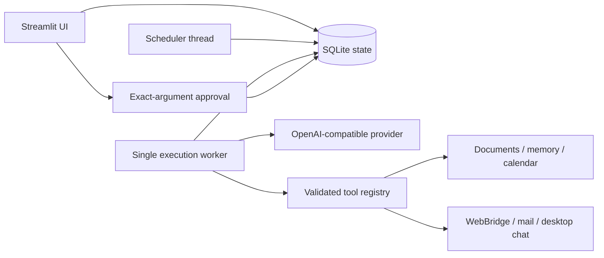
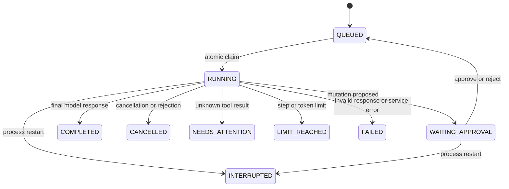

# Architecture

## Scope

The main product is a local, single-user assistant. Streamlit is the presentation
adapter; Python services implement orchestration and storage. There is no public
HTTP backend, distributed worker cluster, subscription system or tenant model.
This keeps deployment proportional to one user's machine and desktop sessions.

## Modules

| Module | Responsibility | Dependencies |
| --- | --- | --- |
| `src/assistant/ui.py` | Navigation, forms, progress, downloads | Services; never owns execution loops |
| `src/assistant/store.py` | Transactions, queue claiming, schedules, approval decisions | Standard library, PathManager |
| `src/assistant/runtime.py` | Bounded model/tool loop, checkpointing, recovery, worker ownership | Store, model transport, registry |
| `src/assistant/model.py` | Bounded HTTP request and response normalization | Runtime model settings |
| `src/assistant/tools.py` | Tool schemas, local capabilities, lazy external adapters | jsonschema; optional adapters |
| `src/tools/` | Existing browser, email, Windows and compatibility adapters | Optional third-party integrations |
| `src/career/` | Isolated legacy recruitment workflow | Own state and scheduler |
| `src/core/system/path_manager.py` | Canonical data paths and legacy migration helpers | Environment settings |

The main application does not call the legacy migration helpers automatically.
It does not initialize the recruitment scheduler. Both applications share user
documents and model configuration but maintain separate operational databases.

## Task lifecycle

`COMPLETED` means the model loop produced a final response. Individual actions
retain their own results; it does not mean delivery to a third party is guaranteed.
The UI explicitly labels answers that used no tools.

## Execution guarantees and limitations

1. Each tool request uses an allowlisted handler and a bounded JSON schema.
2. The action row is written before invocation; an atomic status change claims it.
3. A unique `(task_id, call_id)` prevents reusing one call ID for another action.
4. Identical mutations within a task reuse the stored result. They are not resent.
5. Unknown outcomes stop the task. Restart marks running actions `UNKNOWN`,
   invalidates pending approvals and interrupts queued/running tasks.
6. Approval is for exact stored arguments. Rejection stops the task. Page-sensitive
   click/fill calls also compare a snapshot fingerprint before invocation.
7. Cross-system exactly-once execution is **not** guaranteed. A process may die
   after the external action but before saving its receipt. That case requires
   manual inspection; the design deliberately does not retry it.

One OS file lock owns the execution worker and scheduler. A separate scheduling
thread can enqueue due tasks during model calls. Execution is sequential to avoid
two tasks moving the same browser or desktop conversation. Waiting for approval
releases the worker so other queued tasks can progress. This can change a browser
page; the snapshot check intentionally invalidates stale browser approvals.

## Context and budgets

Each task stores its model/tool messages. Follow-up tasks include up to four
completed parent turns, truncated per message. Tools bound document chunks and
results. The worker reserves a conservative character-based input estimate plus
the maximum output before a model call. Reported API usage is retained when
available; missing usage uses a character estimate and creates a warning event.
This budget controls work conservatively and is not a billing reconciliation.

## Storage

SQLite uses WAL, foreign keys, busy timeouts, and short transactions. The worker
never holds a SQL transaction over a model or browser request. All stored times
are UTC; the UI displays the host's local timezone. Fixed intervals are elapsed
minutes, not calendar-aware recurrence rules. Repeated schedules skip overlapping
unfinished tasks; occurrences missed while offline or more than 90 seconds late
are skipped. On restart all overdue occurrences are skipped.

Schema version 1 owns `tasks`, `actions`, `events`, `schedules`, `memories` and
`preferences`. Future schema changes need explicit migrations and upgrade tests.

## Deliberate boundaries

- Main search is local substring retrieval, not vector RAG. Legacy RAG helpers
  remain for compatibility and are not advertised as a configured main feature.
- Generic browser clicks do not bypass the existing adapter's final-send guards.
- Word generation creates plain paragraphs, not publication-grade layout.
- PDFs must contain extractable text. Main document reading does not perform OCR.
- No arbitrary shell/Python tool, cloud deployment, authentication or payment flow.
- Current evidence is static inspection, not runtime or production validation.
